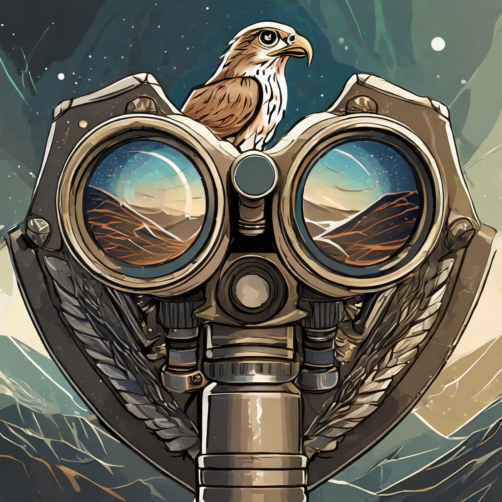

#   Binoculars: Zero-Shot Detection of LLM-Generated Text [[paper]](https://arxiv.org/abs/2401.12070)[[demo]](https://huggingface.co/spaces/tomg-group-umd/Binoculars)

<p align="center">
  
</p>

We introduce Binoculars, a state-of-the-art method for detecting AI-generated text. Binoculars is a
zero-shot and domain-agnostic (requires no training data) method. It is based on a simple idea: most
decoder-only, causal language models have a huge overlap in pretraining datasets, for e.g. Common Crawl, Pile, etc.
More details about the method and results can be found in our paper **Spotting LLMs with Binoculars: Zero-Shot
Detection of Machine-Generated Text**.

## Getting Started

### Installation

The upstream implementation was developed with Python 3.9. This fork's Apple GPU
changes were tested with Python 3.10 in an isolated virtual environment.
To install the Mac GPU branch (requires Python 3.10):

```bash
git clone --branch macos-mps https://github.com/raux/Binoculars.git
cd Binoculars
python3.10 -m venv .venv
source .venv/bin/activate
python -m pip install -e .
python main.py
```

Alternatively, use `uv venv --python 3.10 --seed .venv` to create the environment.
The first inference run downloads both Falcon-7B models (approximately 26 GiB of
cached weights). Subsequent runs reuse the Hugging Face cache. Dependencies are
not fully pinned, so a fresh install may resolve versions different from those
validated below. The original project is [ahans30/Binoculars](https://github.com/ahans30/Binoculars).

### Usage

Please note, this implementation comes with a fixed global threshold that is used to classify the input as AI-generated
or not. This threshold is selected using _Falcon-7B_ and _Falcon-7B-Instruct_ models for scoring. If you want to
use different scoring models, you can pass it as an argument to the `Binoculars` class. Please read the paper for more
details about the Binoculars work.

To detect AI-generated text, please use the following code snippet:

```python
from binoculars import Binoculars

bino = Binoculars()

# ChatGPT (GPT-4) output when prompted with “Can you write a few sentences about a capybara that is an astrophysicist?"
sample_string = '''Dr. Capy Cosmos, a capybara unlike any other, astounded the scientific community with his 
groundbreaking research in astrophysics. With his keen sense of observation and unparalleled ability to interpret 
cosmic data, he uncovered new insights into the mysteries of black holes and the origins of the universe. As he 
peered through telescopes with his large, round eyes, fellow researchers often remarked that it seemed as if the 
stars themselves whispered their secrets directly to him. Dr. Cosmos not only became a beacon of inspiration to 
aspiring scientists but also proved that intellect and innovation can be found in the most unexpected of creatures.'''

print(bino.compute_score(sample_string))  # 0.75661373
print(bino.predict(sample_string))  # 'Most likely AI-Generated'
```

In the above code, user can also pass a `list` of `str` to `compute_score` and `predict` methods to get results for
the entire batch of samples.

### Apple Silicon GPU (MPS)

This fork selects CUDA first, then Apple MPS, then CPU. You can override selection:

```python
bino = Binoculars(device="mps")  # Require Apple GPU; fail if unavailable
# bino = Binoculars(device="cpu")  # Reference CPU run
```

Both models share the Apple GPU. The default bfloat16 precision and classification
thresholds are unchanged; inference disables the unused KV cache. Use a recent
MPS-capable PyTorch/macOS combination supporting bfloat16. Start with a single
text and keep the default 512-token limit. GPU memory is shared with macOS; do
not disable MPS memory safeguards. Unsupported operations raise errors by default
rather than silently changing precision or falling back to CPU.

Validated on an M4 Pro, 64 GB unified memory, macOS 26.5.2, Python 3.10.21,
PyTorch 2.14.0 and Transformers 4.31.0. Other versions/hardware need testing.
CPU and GPU scores may differ, especially near a classification threshold;
these smoke tests do not establish detector accuracy or recalibrate thresholds.

#### Changes in this fork

- `binoculars/detector.py`: adds per-instance `device="auto" | "cpu" | "cuda" | "mps"`
  selection and rejects unavailable explicitly requested backends before loading
  models. CUDA retains its one-/two-GPU routing; both models share one MPS device.
- Synchronizes the selected backend rather than calling CUDA APIs on Apple GPUs.
- Passes `use_cache=False` to both model forwards to avoid unused generation caches.
- `main.py`: computes the score once and reuses it for the classification.
- `tests/test_devices.py`: offline routing, loading, synchronization, cache, and
  scalar/batch scoring tests. `tests/falcon_smoke.py`: opt-in real-model checks.
- `.gitignore`: excludes local generated reports under `artifacts/`.

No model weights, classification thresholds, scoring formulas, or dependency
requirements were changed. No automatic precision conversion was introduced.

#### Measured validation results

On the machine/software combination above, all 11 unit tests passed. Real Falcon
runs verified every model parameter and all four forward outputs on the requested
backend. The GPU run used `PYTORCH_ENABLE_MPS_FALLBACK=0`.

| Workload | CPU scoring | MPS scoring | Speedup | Largest score difference |
| --- | ---: | ---: | ---: | ---: |
| Included capybara sample | 18.24 s | 4.51 s | 4.04× | 0 |
| Padded batch of two short texts | 4.04 s | 1.11 s | 3.64× | 0.003536 |

The capybara score was `0.7566137313842773` on both backends. All three
classifications agreed at the default low-FPR threshold. Model loading and
network downloads are excluded from the scoring timings. These are single-run
measurements, not a repeated benchmark. MPS tensor allocations after scoring
were approximately 28.12 GB (not a peak-memory measurement).

The CPU/MPS comparison passed an absolute score-difference smoke tolerance of
0.01; this tolerance is not an accuracy guarantee. Short texts are included to
exercise padding and batch execution, not to validate detection quality. CUDA
routing was mocked in unit tests, not tested on NVIDIA hardware. The 512-token
limit, larger batches, other precision modes, and Gradio UI were not separately
validated. `python main.py` also passed with automatic MPS selection.

#### Tests

Run offline unit tests (no model downloads):

```bash
python -m unittest discover -s tests -v
```

Run opt-in real-model tests separately to avoid keeping four models in memory:

```bash
PYTORCH_ENABLE_MPS_FALLBACK=0 python tests/falcon_smoke.py --device mps --output artifacts/mps-tests/mps.json
python tests/falcon_smoke.py --device cpu --output artifacts/mps-tests/cpu.json
```

These tests load both Falcon models, verify parameter and output device placement,
and score one sample plus a padded two-text batch. The MPS test requires CPU
fallback to be disabled. Add `HF_HUB_OFFLINE=1` when models are already cached.
The short batch texts test execution only, not detection quality.

### Demo

We have also made a demo available to predict AI-generated text interactively with a simple UI
using [gradio](https://github.com/gradio-app/gradio). You can run the demo using the following command:

```bash
$ python app.py
```

## Limitations

All AI-generated text detectors aim for accuracy, but none are perfect and can have multiple failure modes (e.g.,
Binoculars is more proficient in detecting English language text compared to other languages). This implementation is
for academic purposes only and should not be considered as a consumer product. We also strongly caution against using
Binoculars (or any detector) without human supervision.

## Cite our work

If you find this work useful, please cite our paper:

```bibtex
@misc{hans2024spotting,
      title={Spotting LLMs With Binoculars: Zero-Shot Detection of Machine-Generated Text}, 
      author={Abhimanyu Hans and Avi Schwarzschild and Valeriia Cherepanova and Hamid Kazemi and Aniruddha Saha and Micah Goldblum and Jonas Geiping and Tom Goldstein},
      year={2024},
      eprint={2401.12070},
      archivePrefix={arXiv},
      primaryClass={cs.CL}
}
```
